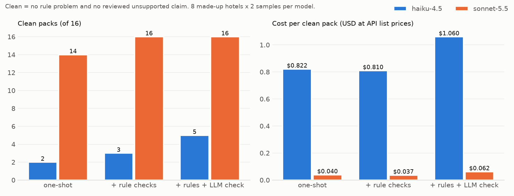
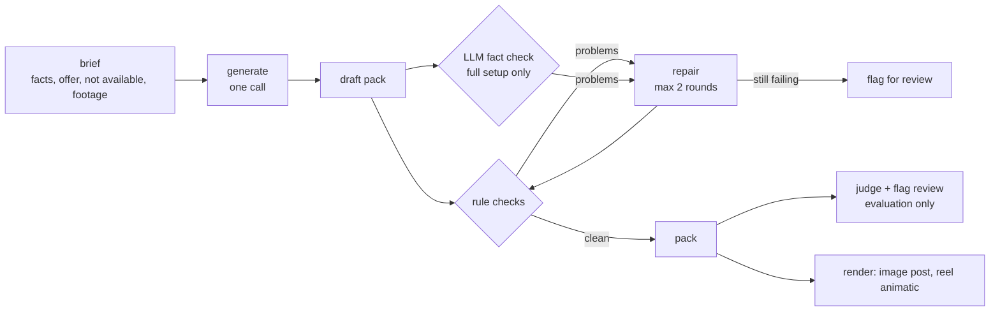

# hotel-content-pipeline

From a hotel's brief to a full ad pack (Google search ads, a Meta ad, an Instagram post, a 15-second reel script and an
image post), with checks that stop the pack from saying things the hotel can't back up.

> Personal project (18 Nov 2026). The eight hotels, their towns, prices and offers are **made up**
> ([briefs/hotels.yaml](briefs/hotels.yaml)). No real hotel, guest or client data is used. Every number below comes
> from the scripts in this repo and the recorded model calls in [cassettes/](cassettes/).



Design notes, failure modes and Q&A: [STUDY.md](STUDY.md). Demo video: [docs/demo.mp4](docs/demo.mp4).
Example renders: [image post](docs/example-post-kiln.png), [reel animatic](docs/example-reel-saltmarsh.mp4).

## Problem

Small hotels now ask AI tools for their ads and social posts. The copy reads well, so it goes out. The risk is in the
details. A Google headline says "20% off" but leaves out "2 nights or more, Sunday to Thursday". A caption promises
"self check-in 24/7" when reception closes at 11pm. A family resort is "on the beach" when the beach is 300 metres
away. In the UK, an ad that leaves out an offer's significant conditions or states something untrue can break the
advertising rules (CAP Code); for a hotel it also means a guest who arrives expecting something that isn't there.
(This is background, not legal advice: check the current CAP Code before relying on it.)

The usual fix is a better prompt. This repo measures whether that is enough, and what checking and repairing a draft
adds, in quality, cost and time.

## Approach

- **Eight made-up briefs** ([briefs/hotels.yaml](briefs/hotels.yaml)): a budget city hotel, a 9-room guesthouse, an
  airport hotel, a country house, a hostel, a spa hotel, a family resort and a design hotel. Each lists its facts,
  prices, one offer with its conditions, what it does **not** have (parking, pool, lift…), and the footage the video
  team already holds. Reel scenes may only use those shots.
- **Three setups, one shared first draft** (so every comparison is paired):
  1. **one-shot**: one call with the full spec and every rule in the prompt ([prompts/generate.txt](prompts/generate.txt));
  2. **+ rule checks**: the draft goes through deterministic checks ([checks.py](src/hotel_content/checks.py)) and up to
     2 repair calls that list the exact problems ([prompts/repair.txt](prompts/repair.txt));
  3. **+ rules + LLM check**: as 2, plus an LLM fact check of every statement against the brief
     ([prompts/check.txt](prompts/check.txt)) before each repair decision.
  A pack that still has known problems after 2 repairs is **flagged for review** instead of shipped.
- **Deterministic checks**: platform limits (Google headlines 30 characters, descriptions 90; Meta primary text 125,
  headline 40; reel on-screen text 32), counts and duplicates, every number must appear in the brief, nothing from the
  not-available list unless negated ("no parking"), no unverifiable superlatives ("best", "luxury", "award-winning"),
  an ad unit that states the offer must also state its key conditions, reel shots must exist and add up to 12–20 s.
- **Two models** through the Claude Code CLI (`claude -p`, tools off, own system prompt): Claude Haiku 4.5 and Claude
  Sonnet 5.5, pipeline calls at `--effort low`. 8 hotels x 2 samples x 2 models = 32 drafts, 96 final packs.
- **Independent judge**: Claude Sonnet 5.5 at default effort, with its own prompt
  ([prompts/judge.txt](prompts/judge.txt)), reads the brief and each final pack and lists invented, contradicted and
  offer-without-terms statements. It never feeds back into a pipeline. Every one of its 109 flags was then reviewed
  against the brief ([audit/labels.yaml](audit/labels.yaml)): 98 kept, 11 overruled as too strict (each with a
  reason). A pack is **clean** when it has no rule problem and no kept judge flag.
- **Cost and time** are the CLI's own figures per call (`total_cost_usd` at API list prices, `duration_ms`), summed
  per pack, sequential.
- **Renders**: the image post (1080x1350) and a reel animatic (540x960 MP4) for each hotel, in its brand colours,
  drawn from the pack ([render.py](src/hotel_content/render.py)). They use labelled photo and footage slots, not stock
  or generated images, so a render can't show something the hotel doesn't have. An editor drops the named shots in.
- **Record/replay and the CI gate**: every model call is stored in `cassettes/`, keyed by a hash of the request.
  GitHub Actions replays them with no API key, checks that the replay reproduces
  [results/summary.json](results/summary.json) exactly, and applies [evals/gate.yaml](evals/gate.yaml): no pipeline
  setup may have fewer clean packs, more unsupported claims or more rule problems than the one-shot draft it started
  from, and Sonnet 5.5 + rule checks must ship no unflagged problem pack.

## Architecture



## Results

<!-- RESULTS:START -->
| Model | Setup | Clean packs | Rule problems | Unsupported claims (judge flags after review) | Flagged for review | Shipped with a problem, unflagged | Calls | Cost per pack | Seconds per pack | Cost per clean pack |
|---|---|---|---|---|---|---|---|---|---|---|
| haiku-4.5 | one-shot prompt | 2/16 | 21 | 41 (judge flagged 45) | n/a | 14 | 1.0 | $0.1027 | 136.7 | $0.8219 |
| haiku-4.5 | + rule checks and repair | 3/16 | 1 | 33 (judge flagged 37) | 1 | 12 | 1.75 | $0.1519 | 201.5 | $0.8101 |
| haiku-4.5 | + rule checks, LLM fact check and repair | 5/16 | 1 | 24 (judge flagged 27) | 5 | 7 | 5.0 | $0.3314 | 467.2 | $1.0604 |
| sonnet-5.5 | one-shot prompt | 14/16 | 2 | 0 (judge flagged 0) | n/a | 2 | 1.0 | $0.0345 | 22.6 | $0.0395 |
| sonnet-5.5 | + rule checks and repair | 16/16 | 0 | 0 (judge flagged 0) | 0 | 0 | 1.12 | $0.0371 | 23.6 | $0.0371 |
| sonnet-5.5 | + rule checks, LLM fact check and repair | 16/16 | 0 | 0 (judge flagged 0) | 1 | 0 | 2.88 | $0.0621 | 35.3 | $0.0621 |

Paired against the one-shot pack from the same draft (95% bootstrap interval over hotel x sample):

| Model | Setup | Clean-pack rate change | Unsupported claims per pack change |
|---|---|---|---|
| haiku-4.5 | + rule checks and repair | +6% [+0%, +19%] | -0.50 [-1.38, +0.44] |
| haiku-4.5 | + rule checks, LLM fact check and repair | +19% [+0%, +38%] | -1.06 [-1.88, -0.31] |
| sonnet-5.5 | + rule checks and repair | +12% [+0%, +31%] | +0.00 [+0.00, +0.00] |
| sonnet-5.5 | + rule checks, LLM fact check and repair | +12% [+0%, +31%] | +0.00 [+0.00, +0.00] |

8 made-up hotels x 2 samples per model. Judge (Claude Sonnet 5.5) cost $1.64 in total, not included above; 0 judge replies unparsed.
<!-- RESULTS:END -->

What this says, on this small test:

1. **The cheaper model was the expensive one.** Sonnet 5.5 at low effort wrote a pack in 23 s for $0.035. Haiku 4.5
   took 137 s and $0.10, because it used 10,000–32,000 output tokens per draft, most of them thinking, and `--effort low` did
   not shorten that. (Haiku 4.5 doesn't support the effort setting, and the CLI ignores the flag for it without a warning:
   [anthropics/claude-code#96386](https://github.com/anthropics/claude-code/issues/96386).) Haiku's cheapest clean pack cost $0.81, against Sonnet's $0.037: 22 times less.
2. **For Sonnet 5.5, rule checks were all it needed.** One-shot packs were clean 14 times out of 16. Both misses
   stated the offer without its conditions. The rule checks caught both and one repair fixed them: 16/16 for
   $0.003 more per pack. The LLM fact check added nothing here (it flagged one pack that the review found clean) and
   raised the cost from $0.037 to $0.062.
3. **For Haiku 4.5, no setup made it safe.** One-shot packs had 21 rule problems (15 of them the offer without its
   conditions, even though the prompt says to include them) and 41 unsupported claims. Across its setups, Haiku wrote "self check-in 24/7", "family
   holidays on the beach" (300 metres away) and "27-inch desks" (the brief says 27-inch *monitors*). Rule checks fixed 20 of the 21 rule problems, but rules
   can't see a claim like "on the beach". The full pipeline cut unsupported claims by 1.06 per pack (95% interval
   −1.88 to −0.31), yet 7 of 16 packs still shipped with a problem nobody had flagged.
4. **Flagging for review mostly works with a strong model.** Sonnet's full setup flagged 1 pack that the review found clean, which
   cost a person a look and nothing else. Haiku's flagged 5, but missed 7.

How sure is this: 16 packs per cell, one judge, and one reviewer for its flags. The Sonnet "+ rule checks" gain
(14 → 16) is inside the noise on its own (interval 0 to +31 points). The Haiku claim reduction and the cost gap are not.

## How to reproduce

```bash
uv sync
uv run pytest -q                       # unit tests for the checks and the gate
uv run python -m hotel_content ci      # replay all 202 recorded calls, rebuild results, apply the gate (no API key)
uv run python -m hotel_content render  # image posts and reel animatics -> renders/
uv run python -m hotel_content demo    # terminal walk-through of one hotel and the results

# re-record (calls the models through the Claude Code CLI; ~25 minutes, ~$8 at list prices)
rm -rf cassettes results && HCP_MODE=record uv run python -m hotel_content run --workers 8
```

The recorded run made 202 calls for $8.25 at API list prices, judge included ($1.64).

## Limitations

- **Small and made up.** 8 briefs, 2 samples per model. The briefs are short and clean; real ones are messier and
  out of date, which is where most wrong claims start.
- **One judge, one reviewer.** The judge is Sonnet 5.5, the same model as one of the writers, so it could be lenient
  towards Sonnet's style. To check, I read all 8 Sonnet packs of one setup in full and found no unsupported claim, but
  a second judge from another vendor would be a fairer test. The flag review was done by the builder (Claude Code),
  not by a hotel marketer.
- **The account adds its own instructions.** These calls went through a Claude Code account whose organisation
  instructions are added to every request (some judge replies end with "verify before use"). They apply equally to
  every setup, but a clean API run would remove them.
- **Cost is CLI-reported at list prices**, not a bill, and the times are one laptop's, sequential, on one evening.
- **Text only.** The renders are layouts with labelled slots. Generating images or video, and checking them, is the
  next problem and a harder one.
- **Rules encode one reading of "significant conditions"** (for example, the 18+ condition on the sparkling-wine offer
  was left to the judge). A legal or brand team would set those per offer.

## What I'd do next

- A second judge from another model family, and a person from hotel marketing reviewing a sample.
- Briefs with stale or conflicting facts (an old PDF says "pool", the update says it's closed).
- An image arm: generated or stock photos, checked against the not-available list by a vision model.
- Owner replies to reviews as a sixth unit, with the private-details leak check from my
  [AI Lab review-reply test](https://github.com/thisisshivamtiwari/ai-lab/tree/main/2026-11-18-review-reply-skill).

Built with Claude Code as a pair programmer.

## Licence

MIT
